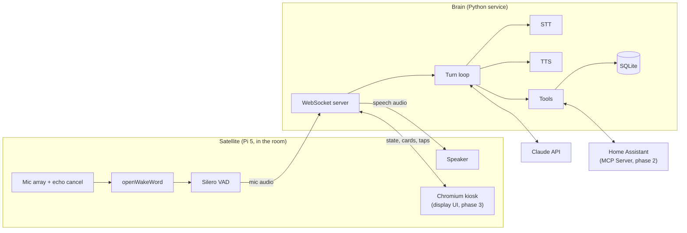
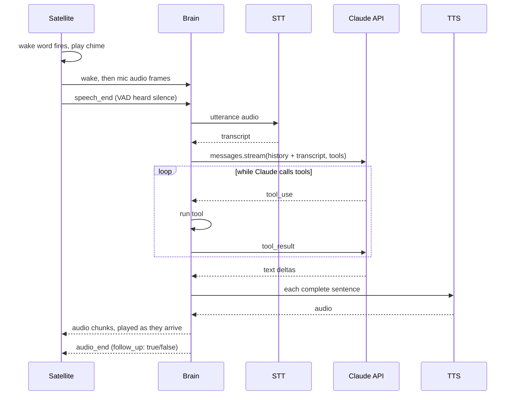

# Architecture

## Goals

- **As fast as Google Home for simple things.** Under 2 s from end of speech to first audio; under 1 s for simple home commands.
- **Much smarter for everything else.** That is the point of using Claude.
- **Private by default.** No audio leaves the device before the wake word.
- **Each phase is usable on its own.** Later phases extend the same system rather than replacing it.

Non-goals for now: full offline operation (we degrade gracefully instead), multi-user
accounts, a phone app (the Home Assistant app already covers remote control).

## Baseline to beat

Home Assistant already ships a voice pipeline (wake word -> STT -> conversation agent -> TTS),
an official Anthropic integration that uses Claude as the conversation agent, and the
Voice Preview Edition satellite. That setup takes an afternoon, needs no code, and gives
a rough version of Phases 1 and 2.

**Set it up first** and use it as the benchmark for latency and answer quality.

We still build our own orchestrator, because:

- **Phase 3 needs a display** whose content is driven by the conversation. Home Assistant's voice satellites are audio-only.
- **We want control of the Claude side:** model choice, prompt caching, sentence-level streaming to TTS, the server-side web search tool, persistent memory, and card output for the screen.
- **Phase 1 works without Home Assistant**, which is the order this project wants.

If the baseline turns out good enough for voice and home control, skip straight to Phase 3
and treat our orchestrator as the display brain.

## System overview

There are two pieces: a **satellite** in each room and one **brain** per house.



**Satellite:** owns everything that must be real-time and local: audio capture, echo
cancellation, wake word, end-of-speech detection, playback, the screen. It holds no API
keys and contains no Claude logic. It is dumb on purpose.

**Brain:** owns everything else: STT, Claude, tools, TTS, timers, memory, conversation
sessions. One Python process on asyncio.

In Phase 1 both run on the same Pi. They still talk over a localhost WebSocket, so adding a
second room, adding a display, or moving the brain to a bigger machine is a config change
rather than a refactor.

## A voice turn



## Tech stack

| Layer | Choice | Why | Swap to if... |
|---|---|---|---|
| Satellite hardware, P1-2 | **Testing:** the Pi 3 and USB headset on hand. **Room use:** Raspberry Pi 5 (4 GB+) and a USB conference speakerphone (Jabra Speak / Anker PowerConf class) | A Pi 3 runs openWakeWord and Silero comfortably, and a headset needs no echo cancellation. For an actual room, a speakerphone gives a mic array, hardware echo cancellation, and a speaker in one USB device. | Run the brain on a desktop PC during development if the Pi 3 is slow at Piper TTS |
| Satellite hardware, P3 | Pi 5, Raspberry Pi Touch Display 2 (or any DSI/HDMI touchscreen), ReSpeaker XVF3800 mic array, amp and speakers | XVF3800 does echo cancellation and beamforming on-chip. Playback must be routed through it so it has the echo reference. | A repurposed Android tablet showing the display UI: cheap, but weaker mics and no control over echo cancellation |
| Wake word | openWakeWord | Open source, runs on the Pi CPU, custom words trainable from synthetic speech, so "Hey Claude" is possible. Use a stock model ("hey jarvis") during development. | Porcupine (commercial) if false triggers are bad; microWakeWord if moving to ESP32 |
| End-of-speech detection | Silero VAD | Small, accurate, CPU-only | |
| Audio I/O | `sounddevice` (PortAudio) over PipeWire | Simple Python API; PipeWire handles per-stream volume for ducking | |
| Language (satellite and brain) | Python with asyncio and `uv`: 3.13 for the brain, 3.11 for the satellite (openWakeWord requires `tflite-runtime` on Linux, which has no builds past 3.11; uv installs 3.11 even though Raspberry Pi OS Trixie ships 3.13) | The voice ecosystem (openWakeWord, Silero, Piper, Whisper) and Home Assistant are all Python | |
| Brain server | `websockets` now; FastAPI + uvicorn once HTTP endpoints arrive (Phase 2 `/announce`) | The satellite link is the only endpoint today. FastAPI later serves WebSockets, HTTP for Home Assistant, and the display UI in one process. | |
| LLM | Claude Agent SDK (`claude-agent-sdk`), one `ClaudeSDKClient` per device | The same code runs on a Claude subscription or an API key; switching is one environment variable. It also handles the tool loop, MCP, streaming, and prompt caching. | Direct Messages API (`anthropic` SDK) if the Claude Code runtime's overhead shows up in latency logs. See [LLM backend](#llm-backend). |
| Default model | Claude Haiku 4.5 (`model="haiku"`) | Voice turns are latency-bound; Haiku is the fastest | Sonnet 5.5 if answers are too shallow. Routing between the two comes later, if ever. |
| STT | Groq Whisper (`whisper-large-v3-turbo`), one request after end of speech | Fast, accurate, very cheap, one HTTP call | Deepgram streaming if STT dominates latency; local `faster-whisper` on a GPU box for privacy and offline |
| TTS | Piper (local) | Free, faster than real time on a Pi, no network hop, still works offline | Cartesia or ElevenLabs streaming for a better voice; Kokoro on a server for good-and-local. Known Piper limit: each sentence is synthesized independently, so pitch and tone can shift between sentences (very noticeable with the Northern English voice). |
| Home control, P2 | Home Assistant's MCP Server integration, passed to the Agent SDK as an HTTP MCP server | Claude gets Home Assistant's Assist tools for exactly the entities exposed to Assist. Scripts exposed to Assist appear as tools automatically, so most new abilities are Home Assistant config, not code. | Direct calls to Home Assistant's WebSocket/REST API for anything MCP doesn't cover |
| Music, P2-3 | Music Assistant (Home Assistant add-on); the satellite runs a player it supports (e.g. Squeezelite) | Spotify, local library, and radio in one place, controllable through Home Assistant, so Claude gets music control for free | Spotify Connect (raspotify) if Spotify is all that matters |
| Storage | SQLite (Python stdlib) | Timers, memory, turn log; one file | |
| Display UI, P3 | Svelte 5 + Vite, served by the brain, shown in Chromium kiosk under `cage` | Small bundles that stay fast on a Pi | |
| Deployment | systemd units | Simplest thing on a Pi | Docker, if the brain moves next to a Docker-based Home Assistant install |

## Satellite <-> brain protocol

One WebSocket per satellite: `ws://brain:8765/satellite?device=kitchen`. JSON text frames
carry control messages; binary frames carry audio. Mic audio is 16 kHz, 16-bit, mono PCM.
Speech audio uses whatever rate the TTS produces, announced in `audio_start`.

Satellite -> brain:

| Message | Meaning |
|---|---|
| `hello {device, capabilities}` | Sent on connect. Capabilities: `speaker`, `display`. |
| `wake` | Wake word fired; mic frames follow |
| *binary* | Mic PCM |
| `speech_end` | VAD heard the end of the utterance |
| `cancel` | Button press or mute during a turn |

Brain -> satellite:

| Message | Meaning |
|---|---|
| `state {idle\|listening\|thinking\|speaking}` | Drives the LED ring now, the screen later |
| `audio_start {sample_rate}` | Speech audio follows |
| *binary* | Speech PCM |
| `audio_end {follow_up}` | If `follow_up` is true, listen again for about 5 s without the wake word |
| `stop` | Stop playback now |
| `volume {level}` | Set output volume |

In Phase 3 the display UI opens a second socket, `ws://brain:8765/display?device=kitchen`.
It receives `state` and `card` messages and sends `tap` and `text` events. The shared
device id ties the two sockets together.

That is the whole protocol, about ten message types. Keep it that small.

## Brain internals

### LLM backend

The brain uses the Claude Agent SDK, which runs the Claude Code binary as a library. It
picks up auth from the environment:

- **`ANTHROPIC_API_KEY` unset:** uses the Claude subscription that Claude Code is logged into on the brain machine. Used during development.
- **`ANTHROPIC_API_KEY` set:** bills the API. Used once the device runs unattended.

Out of the box it behaves like a coding agent, so it gets locked down:

| Option | Value | Why |
|---|---|---|
| `system_prompt` | Our voice prompt, as a plain string | Replaces Claude Code's coding prompt |
| `setting_sources` | `[]` | Don't load CLAUDE.md, hooks, plugins, or skills from `~/.claude` or the project |
| `tools` | No built-ins except `WebSearch` | No shell or file access on the brain machine. Confirm in the session's `system/init` message. |
| `mcp_servers` | Our tools (in-process, via `create_sdk_mcp_server`) and, in Phase 2, Home Assistant over HTTP | |
| `env` / `extra_args` | `ENABLE_CLAUDEAI_MCP_SERVERS=false` and `--strict-mcp-config` | On a subscription login, the account's claude.ai connectors (Gmail, Drive, and so on) load into every session, and `setting_sources=[]` does not stop them. Verified: without these, the init tool list included them. |
| `model` | `haiku` | |
| `include_partial_messages` | `True` | Text deltas for sentence streaming |

The CLI's `--bare` mode does a similar lockdown but never reads subscription credentials,
which is why the options above are set explicitly.

All LLM code lives in one file, `llm.py`, behind one function:
`reply(device, text) -> async iterator of text`. Tools are plain async functions wrapped
with `@tool`. Moving to the direct Messages API later changes only that file, plus an `mcp`
client for Home Assistant.

**Subscription caveats:**

- **Terms.** Subscription login is "designed to support ordinary use of Claude Code and other native Anthropic applications". The explicit prohibitions target developers offering Claude login to *their* users, so single-user use of your own account is not clearly ruled out. But an always-on home appliance is not clearly "ordinary use" either, and Anthropic says it may enforce without notice. Treat the subscription as the development backend and move to an API key before the device runs 24/7. If the project is ever shared, it must use API keys.
- **Rate limits are shared** with your own Claude Code use. A heavy coding day can leave the house assistant rate-limited.
- **Heavier than an HTTP call.** The SDK runs the Claude Code binary as a subprocess. Too much for a 1 GB Pi 3; run the brain on a PC during development.

### Turn loop

1. Transcript arrives. If it is empty or only a word or two of noise (a false wake), drop it without calling Claude.
2. **Instant commands.** "stop", "cancel", "never mind", and "volume up/down" are matched exactly and handled without Claude.
3. **Home fast path (Phase 2).** Send the transcript to Home Assistant's built-in conversation agent (`POST /api/conversation/process`, agent `conversation.home_assistant`). If it matched an intent, speak its reply and stop. Otherwise fall through to Claude. Fast-path commands are appended to the session history so Claude knows they happened.
4. **Claude.** Send the transcript to the device's `ClaudeSDKClient`. The SDK holds the history and runs the tool loop; the brain consumes the text deltas.
5. **Speech.** Split the text stream at sentence boundaries and send each sentence to TTS as soon as it completes. Playing sentence one while sentence two generates is the biggest single latency win.

### Sessions and follow-ups

- One conversation per device, kept in memory. It resets (the device's client is closed and reopened) after 5 minutes idle, so "what about tomorrow?" works without remembering yesterday's chat.
- If Claude's reply ends with a question mark, the brain sets `follow_up: true` and the satellite listens again without the wake word. Crude, but it covers the common case.

### Prompt and caching

- **System prompt:** written for speech. Short answers, no markdown, lists, or URLs; numbers and times said the way a person would say them; at most one clarifying question.
- **Caching** is handled by the Agent SDK.
- **Dynamic context** (current time, room, location, memory facts) is prefixed to each user message rather than baked into the system prompt, so the cached prefix stays stable.

### Tools

| Phase | Tools |
|---|---|
| 1 | `set_timer` / `list_timers` / `cancel_timer`, `remember` / `forget`, `get_weather` (Open-Meteo, no API key), web search (the SDK's built-in `WebSearch`) |
| 2 | Home Assistant MCP tools (automatic), `announce(device \| all, text)` |
| 3 | `show_card` |

**Timers live in the brain**, not in Claude. Each is an asyncio task backed by a SQLite row,
so it survives restarts and rings without a network call. Claude only creates and cancels
them.

**Memory** is a list of facts in SQLite, injected whole into the prompt. That is fine for a
few hundred facts; past that it needs search.

**Announcements and proactive events** come from Home Assistant automations calling the
brain's `POST /announce` endpoint (Phase 3 adds `POST /show` for camera popups).
Home Assistant decides *when*; the brain only speaks or shows. No event subscription logic
in the brain.

## Phase 3: the display

- The display UI is a web app served by the brain, running fullscreen in Chromium under the `cage` kiosk compositor on the satellite.
- It is driven by pushed events from the brain, never by polling.
- **Views:** ambient (clock, weather, photos), conversation (transcript plus card), timers, now playing, home tiles, camera popup.
- **Cards:** Claude calls `show_card({type, ...})` with a fixed set of types: weather, list, timer, media, entity controls, image, text. Voice gives the short answer and the card gives the detail. Fixed types keep rendering predictable; a sandboxed free-form HTML card can come later if they feel limiting.
- **Touch on a home tile calls Home Assistant directly** through the brain, never through Claude. Flipping a light switch must not cost an API call or a second of waiting.
- **Cameras:** Home Assistant streams them over WebRTC (go2rtc is built in). A doorbell automation calls `/show` and the feed pops up.
- **Screen wake and brightness:** scheduled from Home Assistant (sun position, time of day); an optional mmWave presence sensor can wake the screen.
- **Photos:** Immich or a plain folder.

## Latency budget

These are targets to measure against, not measured numbers. Every stage is logged per turn
from day one.

| Stage | Target |
|---|---|
| End-of-speech detection (VAD silence tail) | 400-600 ms |
| STT | under 400 ms |
| Claude, time to first complete sentence | under 900 ms |
| TTS, first audio | under 150 ms |
| **End of speech to first audio** | **under 2 s** (fast path: under 1 s) |

Perceived latency also matters: chime on wake, a short sound at end of speech, and the
`thinking` state on the LEDs or screen. Reuse HTTP clients so connections stay warm.

## Security and privacy

- Audio before the wake word never leaves the satellite. A physical mute switch cuts the mic.
- API keys live only on the brain, in a `.env` file that is never committed. Satellites hold none.
- **No built-in Claude Code tools** (shell, file read/edit) are enabled on the brain. Claude can only call our tools and Home Assistant's.
- The brain uses a **dedicated non-admin Home Assistant user** with its own long-lived token.
- **Claude only sees entities exposed to Assist** (Home Assistant's per-entity exposure setting). This is the main permission boundary: don't expose a lock unless you want it voice controlled.
- **Locks, alarm panels, and garage doors require spoken confirmation**, enforced in the brain's tool dispatch, not just requested in the prompt. Web search results can carry prompt injection, so the rule must not depend on Claude's cooperation.
- The brain listens on the LAN only. No port forwarding. Remote access, if ever needed, goes through Home Assistant's own remote access or Tailscale.
- Turn logs contain transcripts. They stay local and get rotated.

## Failure behavior

| Failure | Behavior |
|---|---|
| Internet down | Wake word, timers, and instant commands still work. Piper says "I can't reach Claude right now." The home fast path also needs STT, so it only works offline if STT is local (`faster-whisper`). |
| Claude API error or timeout | One retry, then a spoken apology |
| Brain down | Satellite plays an error tone and reconnects with backoff |
| Home Assistant down | Claude is told the home tools failed and says so; everything else works |

## Cost estimate

While on the subscription backend there is no per-request cost; usage counts against the plan's limits. The numbers below apply once on an API key.

Prices checked 2026-10-06: Haiku 4.5 at $1 / $5 per million input/output tokens, Sonnet 5.5
at $2 / $10, web search at $10 per 1,000 searches, Groq Whisper turbo at $0.04 per audio
hour with a 10 s minimum per request.

**Assumptions per turn:** about 3.5k input tokens (system prompt, tools, short history) and
about 100 output tokens. A tool call roughly doubles input, because the tool loop sends a
second request.

**Prompt caching saves less than it looks.** The cache lasts 5 minutes and home use is
sparse, so most turns pay the 1.25x cache write rather than the 0.1x read. Caching still
helps inside a turn (the tool loop's second request) and during back-and-forth
conversations. The numbers below assume no cache savings.

| Turn type | Haiku 4.5 | Sonnet 5.5 |
|---|---|---|
| Simple answer | ~$0.004 | ~$0.008 |
| One tool call | ~$0.008 | ~$0.015 |
| Web search (search fee plus result tokens) | ~$0.025 | ~$0.035 |

Monthly, assuming half of turns call a tool:

| Usage | Turns/day | Searches/day | Haiku 4.5 | Sonnet 5.5 |
|---|---|---|---|---|
| Light | 10 | 1 | ~$2.50 | ~$4 |
| Typical | 30 | 3 | ~$7 | ~$13 |
| Heavy | 100 | 8 | ~$23 | ~$40 |

**Phase 2** adds Home Assistant tool definitions and live device state to each request,
which could raise per-turn cost by 50-100% for a large home. The fast path partly offsets
that, because simple device commands never reach Claude.

**Everything else is close to free:** Groq STT is about $0.0001 per request (around $0.10 a
month at typical use), Piper TTS costs nothing, and a Pi draws a few watts (well under $1 a
month in electricity).

Set a monthly spend limit in the Claude Console so a bug, such as a false-wake loop, cannot
run up a bill.

## Rejected alternatives

| Alternative | Why not |
|---|---|
| Home Assistant's Assist pipeline as the core | Covered in [Baseline to beat](#baseline-to-beat): great benchmark, but no display and no control over the Claude side |
| Claude API calling Home Assistant's MCP server directly (MCP connector) | Requires exposing Home Assistant to the internet and adds a network hop. A local MCP client in the brain does the same job. |
| Direct Messages API from day one | Deferred, not rejected. It is the fallback if Agent SDK overhead shows up in latency logs. Starting on the Agent SDK allows running on a subscription during development. |
| Wyoming protocol between satellite and brain | Models Home Assistant's pipeline stages and has no concept of display content. Our protocol is ten messages. |
| ESP32 satellites (Voice PE) | Good hardware, but they speak ESPHome's API to Home Assistant, not to our brain. Revisit for cheap audio-only rooms. |
| Node/TypeScript brain | The voice and ML libraries are Python. TypeScript is used only for the display UI. |

## Repo layout (once code starts)

```
claude-home/
  README.md
  docs/architecture.md
  brain/       Python service
  satellite/   Python audio client
  display/     Svelte app (phase 3)
```
