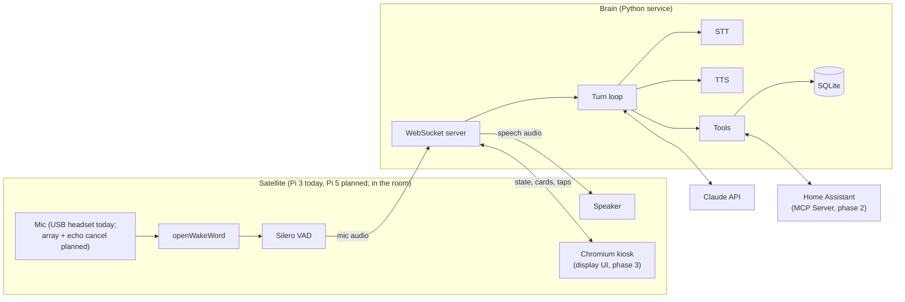
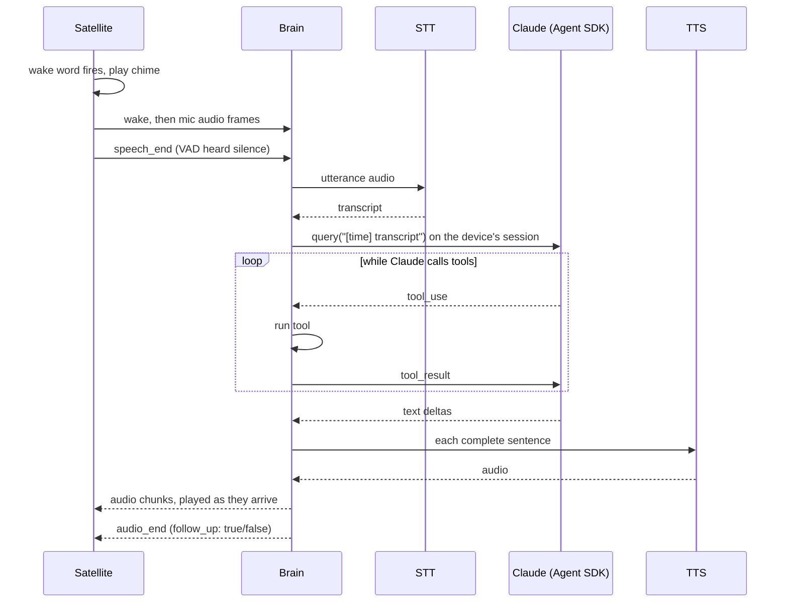

# Architecture

## Goals

- **As fast as Google Home for simple things.** Under 2 s from end of speech to first audio; under 1 s for simple home commands.
- **Much smarter for everything else.** That is the point of using Claude.
- **Private by default.** No audio leaves the device before the wake word.
- **Each phase is usable on its own.** Later phases extend the same system rather than replacing it.

Non-goals for now: full offline operation (we degrade gracefully instead), multi-user
accounts, a phone app (the Home Assistant app already covers remote control).

## Baseline to beat

Home Assistant already ships a voice pipeline (wake word -> STT -> conversation agent -> TTS),
an official Anthropic integration that uses Claude as the conversation agent, and the
Voice Preview Edition satellite. That setup takes an afternoon, needs no code, and gives
a rough version of Phases 1 and 2.

**Set it up first** and use it as the benchmark for latency and answer quality.

We still build our own orchestrator, because:

- **Phase 3 needs a display** whose content is driven by the conversation. Home Assistant's voice satellites are audio-only.
- **We want control of the Claude side:** model choice, prompt caching, sentence-level streaming to TTS, the server-side web search tool, persistent memory, and card output for the screen.
- **Phase 1 works without Home Assistant**, which is the order this project wants.

If the baseline turns out good enough for voice and home control, skip straight to Phase 3
and treat our orchestrator as the display brain.

## System overview

There are two pieces: a **satellite** in each room and one **brain** per house.



**Satellite:** owns everything that must be real-time and local: audio capture, echo
cancellation, wake word, end-of-speech detection, playback, the screen. It holds no API
keys and contains no Claude logic. It is dumb on purpose.

**Brain:** owns everything else: STT, Claude, tools, TTS, timers, memory, conversation
sessions. One Python process on asyncio.

They talk over WebSockets, so adding a second room, adding a display, or moving the brain to a
bigger machine is a config change rather than a refactor. Today the brain runs on a Windows PC
(the Agent SDK is too heavy for a 1 GB Pi 3), and the Pi 3 runs the satellite, the display kiosk,
and raspotify.

## A voice turn



## Tech stack

| Layer | Choice | Why | Swap to if... |
|---|---|---|---|
| Satellite hardware, P1-2 | **Testing:** the Pi 3 and USB headset on hand. **Room use:** Raspberry Pi 5 (4 GB+) and a USB conference speakerphone (Jabra Speak / Anker PowerConf class) | A Pi 3 runs openWakeWord and Silero comfortably, and a headset needs no echo cancellation. For an actual room, a speakerphone gives a mic array, hardware echo cancellation, and a speaker in one USB device. | Run the brain on a desktop PC during development if the Pi 3 is slow at Piper TTS |
| Satellite hardware, P3 | Pi 5, Raspberry Pi Touch Display 2 (or any DSI/HDMI touchscreen), ReSpeaker XVF3800 mic array, amp and speakers | XVF3800 does echo cancellation and beamforming on-chip. Playback must be routed through it so it has the echo reference. | A repurposed Android tablet showing the display UI: cheap, but weaker mics and no control over echo cancellation |
| Wake word | openWakeWord | Open source, runs on the Pi CPU, custom words trainable from synthetic speech, so "Hey Claude" is possible. Use a stock model ("hey jarvis") during development. | Porcupine (commercial) if false triggers are bad; microWakeWord if moving to ESP32 |
| End-of-speech detection | Silero VAD | Small, accurate, CPU-only | |
| Audio I/O | `sounddevice` (PortAudio) on plain ALSA, configured by `satellite/asound.conf` | Simple Python API. ALSA's dmix lets the voice and music play at once. Two `softvol` controls: `Master` on the default output is the speaker's volume for everything, and `music` (control `Music`) gives music its own level on top, so the satellite can duck it with `amixer`. Software controls behave the same whatever speaker is plugged in. | PipeWire, if per-stream routing gets more complicated |
| Language (satellite and brain) | Python with asyncio and `uv`: 3.13 for the brain, 3.11 for the satellite (openWakeWord requires `tflite-runtime` on Linux, which has no builds past 3.11; uv installs 3.11 even though Raspberry Pi OS Trixie ships 3.13) | The voice ecosystem (openWakeWord, Silero, Piper, Whisper) and Home Assistant are all Python | |
| Brain server | FastAPI + uvicorn | One process serves the satellite and display WebSockets, the display page, photos, and the Spotify login; Phase 2's `/announce` joins them. | |
| LLM | Claude Agent SDK (`claude-agent-sdk`), one `ClaudeSDKClient` per device | The same code runs on a Claude subscription or an API key; switching is one environment variable. It also handles the tool loop, MCP, streaming, and prompt caching. | Direct Messages API (`anthropic` SDK) if the Claude Code runtime's overhead shows up in latency logs. See [LLM backend](#llm-backend). |
| Default model | Claude Haiku 5.5 (`model="claude-haiku-5-5"`, pinned: the bundled Claude Code's `haiku` alias still meant 4.5) | Voice turns are latency-bound; Haiku is the fastest | Sonnet 5.5 if answers are too shallow. Routing between the two comes later, if ever. |
| STT | Groq Whisper (`whisper-large-v3-turbo`), one request after end of speech | Fast, accurate, very cheap, one HTTP call | Deepgram streaming if STT dominates latency; local `faster-whisper` on a GPU box for privacy and offline |
| TTS | Piper (local) | Free, faster than real time on a Pi, no network hop, still works offline | Cartesia or ElevenLabs streaming for a better voice; Kokoro on a server for good-and-local. Known Piper limit: each sentence is synthesized independently, so pitch and tone can shift between sentences (very noticeable with the Northern English voice). |
| Home control, P2 | Home Assistant's MCP Server integration, passed to the Agent SDK as an HTTP MCP server | Claude gets Home Assistant's Assist tools for exactly the entities exposed to Assist. Scripts exposed to Assist appear as tools automatically, so most new abilities are Home Assistant config, not code. | Direct calls to Home Assistant's WebSocket/REST API for anything MCP doesn't cover |
| Music | Spotify Connect: raspotify (librespot) on the Pi, controlled by the brain through the Spotify Web API | Spotify is what the household uses, and it needed no Home Assistant. Auth is PKCE, so there's no client secret. | Music Assistant (Home Assistant add-on) for a local library and radio, once Phase 2 is in |
| Storage | SQLite (Python stdlib) | Timers, alarms, memory; one file. Two append-only logs sit beside it: `turns.jsonl` (each turn's transcript, reply, and stage timings) and `ha_actions.jsonl` (each Home Assistant action Claude takes, with what was heard). | |
| Display UI, P3 | Plain HTML, CSS, and ES modules (`brain/display/`), no build step, served by the brain, shown in Chromium kiosk under `cage`. Fraunces and Inter are bundled. | One page with a handful of screens didn't need a framework, and nothing to build means the Pi gets changes on the next brain restart | Svelte 5 + Vite if the page outgrows one script |
| Deployment | systemd units | Simplest thing on a Pi | Docker, if the brain moves next to a Docker-based Home Assistant install |

## Satellite <-> brain protocol

One WebSocket per satellite: `ws://brain:8765/satellite?device=kitchen`. JSON text frames
carry control messages; binary frames carry audio. Mic audio is 16 kHz, 16-bit, mono PCM.
Speech audio uses whatever rate the TTS produces, announced in `audio_start`.

Satellite -> brain:

| Message | Meaning |
|---|---|
| `hello {device, capabilities}` | Sent on connect. Capabilities: `speaker`. |
| `wake` | Wake word fired (or `listen` arrived); mic frames follow |
| *binary* | Mic PCM |
| `speech_end` | VAD heard the end of the utterance |
| `cancel` | Wake word fired but nobody spoke |
| `ring_speech` | The mic PCM just sent is speech heard while something rang, without the wake word. The brain transcribes it and stops (or snoozes) the ringing if it hears "stop" (or "snooze"); anything else is ignored, never sent to Claude. |
| `text {text}` | A typed request; skips speech-to-text (testing) |
| `played` | A reply finished playing (not sent for announcements, so a timer ending mid-conversation doesn't end it on screen) |
| `volume {level}` | The speaker's volume (0-100, the `Master` control), on connect and after every change |

Brain -> satellite:

| Message | Meaning |
|---|---|
| `audio_start {sample_rate}` | Speech audio follows |
| *binary* | Speech PCM |
| `audio_end {follow_up}` | If `follow_up` is true (the reply ended with a question), listen again without the wake word |
| `audio_start` / `audio_end` with `announce: true` | Unprompted speech, such as a finished timer or an alarm. Can arrive at any time; the satellite always listens for it. |
| `listen` | Start listening as if the wake word fired (tap-to-talk on a screen) |
| `ringing {on}` | An alarm or timer started or stopped ringing here. While on, the satellite also sends any speech it hears (`ring_speech`), so "stop" works without the wake word. |
| `stop` | Drop all queued audio now (Stop on a screen, a stopped reply, a silenced alarm) |
| `volume {level}` | Set the speaker's volume: the `Master` software control from `asound.conf` (`amixer -c 2 sset Master`), not the USB device's own control, which some devices ignore |

**Ducking is the satellite's job:** on wake or `listen` it sets the ALSA `Music` control to 20%,
and back to 100% once the reply has played or the request was cancelled. Music players
(raspotify) play through the `music` device that control belongs to.

### Display protocol

Each screen opens `ws://brain:8765/display?device=kitchen`. The device id ties it to that
room's satellite: everything the satellite's conversation does shows on every screen of the
device. Messages are JSON.

Brain -> display:

| Message | Meaning |
|---|---|
| `hello {device, version, night: {start, end}}` | On connect. `version` changes when the display code does; a screen that sees a new one reloads itself. |
| `state {state}` | `idle`, `listening`, `thinking`, or `speaking` |
| `heard {text}` | What the person said |
| `reply {text}` | One more sentence of Claude's reply, sent just before its audio |
| `card {card}` | Open a sheet (kinds below) |
| `ambient {weather, timers, next_alarm, agenda}` | Home screen data: on connect, when timers or the next alarm change, and on each weather or calendar refresh |
| `now_playing {track}` | `null`, or `{title, artist, album, art, uri, is_playing, progress_ms, duration_ms}`; sent when the track, play state, or position really changes (screens advance the position themselves) |
| `ringing {ringing}` | `null`, the ringing alarm `{kind: "alarm", id, label, time}`, or a finished timer `{kind: "timer", label}` |
| `volume {level}` | The speaker's level |
| `camera {entity, name}` | Open a Home Assistant camera's live view (see Cameras below); `entity: null` closes it |

Card kinds: `weather` (the forecast), `timers` (each with `ends_at` epoch seconds, `duration` in seconds, and `paused_left`: seconds left while paused, else null), `alarms`,
`shopping {groups}` (each `{name, items}`: a Todoist section, uncategorized first with name `""`), `agenda {events}`, `briefing` (forecast, today's events, next alarm, timers,
shopping count), `recipe {title, ingredients, steps, step}` (step -1 is the ingredients),
`text {title, lines}` (Claude's `show_on_screen`), `volume {level}`, and `music` (no data; the
screen shows what it knows is playing).

Display -> brain:

| Message | Effect |
|---|---|
| `talk` | The satellite starts listening (and a ringing alarm or timer stops) |
| `stop` | Silence a ringing alarm or timer, else cut the reply short, else drop queued audio |
| `snooze` | Snooze the ringing alarm 9 minutes |
| `open {sheet}` | Reply (to this screen only) with the card for `weather`, `timers`, `alarms`, `shopping`, or `agenda` |
| `shopping_remove {item}` | Remove it; this screen gets the updated list |
| `timer_pause {id}`, `timer_resume {id}`, `timer_cancel {id}` | From the timers sheet (Pause, Resume, Stop) |
| `alarm_toggle {id, enabled}`, `alarm_delete {id}` | From the alarms sheet |
| `media {action}` | `play`, `pause`, `next`, or `previous` on Spotify |
| `volume {level}` | Set the speaker's level |
| `recipe {action}` | `next` or `previous` (every screen of the device follows), or `close` (ends recipe mode) |
| `text {text}` | Run a turn as if it had been spoken |

Keep both protocols small: a screen shows what the brain tells it and sends what was touched.

## Brain internals

### LLM backend

The brain uses the Claude Agent SDK, which runs the Claude Code binary as a library. It
picks up auth from the environment:

- **`ANTHROPIC_API_KEY` unset:** uses the Claude subscription that Claude Code is logged into on the brain machine. Used during development.
- **`ANTHROPIC_API_KEY` set:** bills the API. Used once the device runs unattended.

Out of the box it behaves like a coding agent, so it gets locked down:

| Option | Value | Why |
|---|---|---|
| `system_prompt` | Our voice prompt, as a plain string | Replaces Claude Code's coding prompt |
| `setting_sources` | `[]` | Don't load CLAUDE.md, hooks, plugins, or skills from `~/.claude` or the project |
| `tools` | No built-ins except `WebSearch` | No shell or file access on the brain machine. Confirm in the session's `system/init` message. |
| `allowed_tools`, `permission_mode` | `WebSearch`, `mcp__home__*`, `mcp__ha__*`; `"dontAsk"` | Nobody is there to approve a tool call; anything not allowed is refused |
| `disallowed_tools` | Home Assistant's timer, to-do list, time, and broadcast tools | The brain already does these itself: timers ring here, the shopping list is Todoist, and the time is in every message |
| `mcp_servers` | Our tools (in-process, via `create_sdk_mcp_server`) and Home Assistant's MCP Server over HTTP when `HA_URL` is set | |
| `hooks` | `PostToolUse` and `PostToolUseFailure` on `mcp__ha__.*` | Appends each Home Assistant action (not `GetLiveContext` lookups) to `ha_actions.jsonl` |
| `env` / `extra_args` | `ENABLE_CLAUDEAI_MCP_SERVERS=false` and `--strict-mcp-config` | On a subscription login, the account's claude.ai connectors (Gmail, Drive, and so on) load into every session, and `setting_sources=[]` does not stop them. Verified: without these, the init tool list included them. |
| `model` | `claude-haiku-5-5` | |
| `include_partial_messages` | `True` | Text deltas for sentence streaming |

The CLI's `--bare` mode does a similar lockdown but never reads subscription credentials,
which is why the options above are set explicitly.

The Claude call lives in one function, `ask(client, text)` in `brain/brain.py`, which yields the
reply a sentence at a time. Tools are plain async functions wrapped with `@tool` in
`brain/tools.py`. Moving to the direct Messages API later changes `ask()` and how tools are
registered, plus an `mcp` client for Home Assistant.

**Subscription caveats:**

- **Terms.** Subscription login is "designed to support ordinary use of Claude Code and other native Anthropic applications". The explicit prohibitions target developers offering Claude login to *their* users, so single-user use of your own account is not clearly ruled out. But an always-on home appliance is not clearly "ordinary use" either, and Anthropic says it may enforce without notice. Treat the subscription as the development backend and move to an API key before the device runs 24/7. If the project is ever shared, it must use API keys.
- **Rate limits are shared** with your own Claude Code use. A heavy coding day can leave the house assistant rate-limited.
- **Heavier than an HTTP call.** The SDK runs the Claude Code binary as a subprocess. Too much for a 1 GB Pi 3; run the brain on a PC during development.

### Turn loop

1. Transcript arrives. If it is empty or only a word or two of noise (a false wake), drop it without calling Claude.
2. **Instant commands.** "stop", "cancel", "never mind", and Whisper's usual noise transcripts ("you", "thank you") are dropped without calling Claude. Volume changes go through Claude's `set_volume` tool for now.
3. **Home fast path (Phase 2, not built yet).** Send the transcript to Home Assistant's built-in conversation agent (`POST /api/conversation/process`, agent `conversation.home_assistant`). If it matched an intent, speak its reply and stop. Otherwise fall through to Claude. Fast-path commands are appended to the session history so Claude knows they happened.
4. **Claude.** Send the transcript to the device's `ClaudeSDKClient`. The SDK holds the history and runs the tool loop; the brain consumes the text deltas.
5. **Speech.** Split the text stream at sentence boundaries and send each sentence to TTS as soon as it completes. Playing sentence one while sentence two generates is the biggest single latency win.

### Sessions and follow-ups

- One conversation per device, kept in memory for as long as its satellite stays connected, so "what about tomorrow?" works. (Planned: reset it after a few minutes idle, so it doesn't carry yesterday's chat.)
- If Claude's reply ends with a question mark, the brain sets `follow_up: true` and the satellite listens again without the wake word. Crude, but it covers the common case.

### Prompt and caching

- **System prompt:** written for speech. Short answers, no markdown, lists, or URLs; numbers and times said the way a person would say them; at most one clarifying question.
- **Caching** is handled by the Agent SDK.
- **Dynamic context:** the current time is prefixed to each user message rather than baked into the system prompt, so the cached prefix stays stable. Saved memory facts are added to the system prompt when the device's session starts.

### Tools

| Phase | Tools |
|---|---|
| 1 | `set_timer` / `list_timers` / `cancel_timer` / `pause_timer` / `resume_timer` (by name; an unlabeled timer is named by its length, "5 minute timer"), `remember` / `forget`, shopping list (`add_to_` / `remove_from_` / `get_` / `clear_shopping_list`), `get_weather` (Open-Meteo, no API key), web search (the SDK's built-in `WebSearch`) |
| 2 | Home Assistant MCP tools (automatic, minus the ones the brain already does; see [LLM backend](#llm-backend)), `announce(device \| all, text)` (not started) |
| 3 | `set_alarm` / `list_alarms` / `cancel_alarm`, `show_on_screen(title, lines)`, `get_agenda(days)`, `morning_briefing`, `show_recipe` / `recipe_step(direction)`, `play_music(query, kind)` / `pause_music` / `resume_music` / `skip_track` / `previous_track` / `whats_playing`, `set_volume(level, relative)`, `show_camera(camera)` / `close_camera` |

Tools whose result belongs on the screen (timers, alarms, weather, the shopping list, the
calendar, the briefing, recipes, volume) push the matching card to the device's screens as they
run, so the picture arrives with or before the spoken answer.

**Adding a tool** is one `@tool` function inside `tool_list()` in `brain/tools.py` (name, a description Claude reads to decide when to use it, and a JSON schema for its arguments), added to the list it returns.

**The shopping list** is a Todoist project (`TODOIST_SHOPPING_PROJECT`, default `Shopping List`), so it's the same list in the Todoist app. `brain/todoist.py` calls Todoist's REST API with a personal API token. The brain makes the calls itself, not Claude through a Todoist MCP server: the screen's check-offs never go through Claude, and the tools work the same whether Claude runs through the Agent SDK or the plain API. Removing an item checks it off, so it can be found under completed tasks in Todoist. The project's sections are the list's categories: Claude names one for each item it adds (matched loosely, so "dairy" finds "Meat & Dairy"), every shopping tool result lists the current ones, and the screen shows a heading per section.

**Timers live in the brain**, not in Claude. Each is a SQLite row, and one loop checks for
finished timers every half second, so timers survive restarts and ring without a network
call. A finished timer rings like an alarm (below, without Snooze): its name is spoken, then
beeps every 4 s until stopped or 10 minutes pass. A timer that ran out while the brain was down
rings as soon as a satellite connects. Claude only creates and cancels them.

**Alarms live in the brain too:** a SQLite row with a time (`"HH:MM"`), repeat days (weekday
digits, Monday = 0: `"01234"` is weekdays, `""` is once), a label, an on/off flag, and the next
ring time, computed by one pure function (`next_ring`). The same half-second loop rings them: the
screens turn marigold, the time and label are spoken once, then beeps every 4 s until Stop, Snooze
(9 minutes), the wake word, tap-to-talk, or 10 minutes pass. Saying "stop" or "snooze" works
without the wake word: while something rings, the satellite sends any speech it hears to the brain,
which checks the transcript for those words (and a few like them: cancel, off, enough). One-time alarms are deleted after;
repeating ones get their next time. An alarm more than 10 minutes overdue (the brain was down) is
skipped rather than rung late.

**Memory** is a list of facts in SQLite, injected whole into the prompt. That is fine for a
few hundred facts; past that it needs search.

**Announcements and proactive events** come from Home Assistant automations calling the
brain's `POST /announce` endpoint (not built yet) and `POST /show?device=&camera=` for camera popups.
Home Assistant decides *when*; the brain only speaks or shows. No event subscription logic
in the brain.

## Phase 3: the display

Built so far on the Pi 3 with a 5" 800x480 HDMI touchscreen (USB touch), with the brain on the PC.

- **The page** (`brain/display/`: `index.html`, `style.css`, `app.js`) is served by the brain and runs fullscreen in Chromium under the `cage` kiosk compositor. It is driven by pushed messages (the [display protocol](#display-protocol)), never by polling the brain, and reconnects by itself; after 5 s offline it says so.
- **Screens:** home (clock, date, weather, and a strip of timers, the next alarm, the next event, and the song playing, over the photo slideshow); the conversation overlay (one "state light" for listening, thinking, and speaking; what was heard; the reply growing sentence by sentence; Stop); sheets that slide up for weather, timers (a dial each that drains as time runs out, with Pause and Stop), alarms, shopping list, calendar, briefing, recipe, music, volume, the menu, and Claude's `show_on_screen` text; a camera's live view; the ringing screen; and night mode.
- **Navigation:** every screen has a visible close control, and every sheet returns home after 45 s untouched (a recipe after 30 minutes, since a step can simmer that long; ringing never times out on its own).
- **Touch never goes through Claude:** checking off a shopping item, cancelling a timer, toggling an alarm, the media buttons, and the volume slider are messages straight to the brain. Flipping a switch must not cost an API call or a second of waiting.
- **Night mode** is computed in the page from `hello.night` (`NIGHT_START` / `NIGHT_END`): pure black with a dim clock in the day clock's place, no photos fetched; a tap brings the home screen back for 30 s. Ringing, conversations, and sheets still come up over it.
- **Photos:** `PHOTOS_DIR` (default `~/Pictures/Claude Home`). `GET /photos` lists JPEG, PNG, and WebP files (shuffled; HEIC is skipped); `GET /photos/{name}` returns one cover-resized to 800x480 with EXIF rotation applied, cached in `brain/.cache/photos/`. Names that would leave the folder are refused. The page crossfades to the next photo every 30 s and takes its accent color from it (the most colorful mid-tone, clamped so it always reads), falling back to marigold.
- **Calendar** (`brain/agenda.py`): every `CALENDAR_<LABEL>` variable is one secret iCal address (never logged), fetched in the background every 15 minutes, or after a minute when one failed. A failed feed keeps its last good copy. Each refresh expands today through the next 7 days in local time with `recurring-ical-events`, dropping cancelled occurrences and flagging all-day events.
- **Spotify** (`brain/spotify.py`): the PKCE authorization code flow (no client secret) through `/spotify/login` and `/spotify/callback`; tokens in `brain/spotify_token.json`, refreshed within a minute of expiry. Asked by voice, the song starts once Claude's reply has finished playing (the device goes idle), so it doesn't begin under the voice and the ducking; the search and the speaker check happen during the turn, so Claude can name the song or say what's wrong, and a failure after that goes on the screen. `play` finds the speaker named `SPOTIFY_DEVICE` (default "Claude Home"), and plays on it with one command naming the device (a separate transfer first raced the play in librespot, and Spotify then reported the speaker's previous track). It checks that Spotify reports that track, or the album or playlist, playing there within 6 s; if not, it sends the command once more (librespot only notices that Spotify closed its session when a command arrives, and that command is lost). A 429 stops all requests until its `Retry-After` has passed. The brain polls `GET /me/player` every 5 s while playing and 20 s otherwise, and a control makes it look again a second later.
- **Performance on the Pi 3's GPU:** only `opacity` and `transform` animate; no blur, `backdrop-filter`, or large shadows; at most two photo layers; nothing runs while idle except the once-a-minute clock and the slideshow timer.
- **Cameras:** Home Assistant's cameras are listed once at startup (name, entity, and area, so "the front yard camera" finds the one in the Front Yard area). Claude's `show_camera` tool, or `POST /show?device=&camera=` from an automation (the doorbell), sends `camera {entity, name}` to the device's screens, which open a full-screen live view with the name and a close button. The video is WebRTC straight from Home Assistant (for Ring, Ring's servers) to the page; the brain's `/camera?entity=` socket only relays the setup (offer, answer, ICE candidates) over Home Assistant's WebSocket API, so the token never reaches the screen. Closing the view closes the socket, which ends the stream. A view closes itself after 2 minutes (Ring reports a battery level even for plugged-in cameras, so battery ones can't be singled out for less), and goes back home 3 s after Ring ends it. Measured on the Pi 3 with the Ring Indoor Cam: 1080p at 15 fps, about 6 s to the first frame, roughly one core of CPU while it plays. Ring serves one live view per camera at a time; a second screen opening the same camera gets no video.
- **Later:** Home Assistant tiles, screen brightness from Home Assistant, and the Pi 5 hardware with the mic array.

### On the Pi

- **Kiosk:** `satellite/claude-home-display.service` runs `cage` + Chromium on tty1 as the desktop user (`getty@tty1` disabled). It opens `satellite/kiosk.html` first, a local page that waits for the brain and then switches to the display, because Chromium shows a dead error page if the brain is down when it starts. `LANG=en_US.UTF-8` in the unit gives the page US clock and date formats. Screens reload themselves when the brain restarts with new display code, so deploying the page is just restarting the brain.
- **Audio:** `satellite/asound.conf` as `/etc/asound.conf` makes the USB headset (card 2) the default for every user, shares it through ALSA's dmix (with `ipc_perm 0666`, because raspotify runs as its own user and would otherwise lock the satellite out), puts every sound through the `Master` software volume, and adds the `music` device with its `Music` volume control on top. Software controls appear the first time something plays.
- **raspotify** (librespot) runs as `raspotify.service`. Its settings are appended to `/etc/raspotify/conf` (the original is kept as `conf.orig`): `LIBRESPOT_NAME="Claude Home"`, `LIBRESPOT_DEVICE=music`, `LIBRESPOT_DEVICE_TYPE=speaker`, `LIBRESPOT_INITIAL_VOLUME=100`. Two stock lines are commented out: `LIBRESPOT_DISABLE_CREDENTIAL_CACHE` (with it, librespot forgets its Spotify login on every restart) and `LIBRESPOT_ENABLE_VOLUME_NORMALISATION` (it made music noticeably quieter than the voice on the headset). `LIBRESPOT_QUIET` is off: the watchdog reads librespot's info log.
- **System log:** Raspberry Pi OS keeps the journal in memory (`Storage=volatile`, about 10 hours here, gone on reboot). `/etc/systemd/journald.conf.d/50-claude-home-persistent.conf` overrides it with `Storage=persistent` and `SystemMaxUse=200M`, so librespot, watchdog, and satellite history survives for debugging.
- **raspotify watchdog:** `satellite/raspotify-watchdog.service` (root) runs `raspotify-watchdog.sh`, which restarts raspotify when librespot logs `Connection to server closed` and hasn't logged `Authenticated as` within 30 s. librespot 0.8.0 sometimes never logs in again on its own; after a restart it is back in Spotify's device list within 10 s. `brain/spotify_lab.py` checks the whole chain from the PC (`check`, `cold-start`, `soak`, `play`).

## Latency budget

Every stage is logged per turn in `turns.jsonl`. Measured: medians (and 90th percentiles) over
the 77 spoken turns with a reply from 2026-10-06 to 2026-10-08, with the brain on the PC and
Claude on the Agent SDK.

| Stage | Target | Measured |
|---|---|---|
| End-of-speech detection (VAD silence tail) | 400-600 ms | 700 ms (`END_SILENCE_S`; not in the log) |
| STT | under 400 ms | 0.67 s (1.12 s) |
| Claude, time to first complete sentence | under 900 ms | 2.31 s (4.65 s) |
| TTS, first audio | under 150 ms | 0.12 s (0.29 s) |
| **End of speech to first audio** | **under 2 s** (fast path: under 1 s) | **3.10 s (5.64 s)**, not counting the silence tail |

Claude's first sentence is most of the gap. The log doesn't record which turns called a tool or
searched the web, so those are mixed into the same numbers. If that stage doesn't come down, the
next step is the direct Messages API (see [LLM backend](#llm-backend)).

Perceived latency also matters: chime on wake, a short sound at end of speech, and the
`thinking` state on the LEDs or screen. Reuse HTTP clients so connections stay warm.

## Security and privacy

- Audio before the wake word never leaves the satellite, with one exception: while an alarm or timer rings, speech is sent to the brain so "stop" works without the wake word (that transcript is only checked for stop and snooze words, never sent to Claude). Planned: a physical mute switch on the Pi 5 build.
- API keys live only on the brain, in a `.env` file that is never committed. Satellites hold none.
- **No built-in Claude Code tools** (shell, file read/edit) are enabled on the brain. Claude can only call our tools and Home Assistant's.
- The brain should use a **dedicated non-admin Home Assistant user** with its own long-lived token.
- **Claude only sees entities exposed to Assist** (Home Assistant's per-entity exposure setting). This is the main permission boundary: don't expose a lock unless you want it voice controlled.
- **Not built yet: spoken confirmation for locks, alarm panels, and garage doors**, to be enforced in the brain (a `PreToolUse` hook on `mcp__ha__*` is the natural place), not just requested in the prompt. Web search results can carry prompt injection, so the rule must not depend on Claude's cooperation. Until it exists, don't expose those to Assist.
- Every Home Assistant action Claude takes is logged to `ha_actions.jsonl` with the transcript that led to it, so a surprise in the house can be traced to a mishearing or to Claude's choice.
- The brain listens on the LAN only. No port forwarding. Remote access, if ever needed, goes through Home Assistant's own remote access or Tailscale.
- Turn logs contain transcripts. They stay local (git-ignored). Not rotated yet; `turns.jsonl` grows by about 330 bytes a turn.

## Failure behavior

| Failure | Behavior |
|---|---|
| Internet down | Wake word, timers, and alarms still work. Planned: Piper says "I can't reach Claude right now." The home fast path also needs STT, so it only works offline if STT is local (`faster-whisper`). |
| Claude API error or timeout | A spoken apology ("Claude is rate limited right now" for a 429), unless part of the reply was already spoken. No retry. |
| Speech to text fails (Groq down or unreachable) | Not handled yet: the error ends the satellite's connection, which reconnects within seconds, and nothing is said |
| Brain down | The satellite reconnects every few seconds (no error tone yet). Screens say "Can't reach Claude Home" after 5 s and reconnect on their own; the kiosk waits on its start page if the brain is down when the Pi boots. |
| A calendar feed or the weather fails | The last good copy stays on screen; calendars retry after 1 minute, weather after 2 |
| Spotify unreachable or the speaker missing | Claude says what Spotify reported (for example, that the Claude Home speaker isn't showing up); the rest works |
| Home Assistant down | Claude is told the home tools failed and says so; everything else works |

## Cost estimate

While on the subscription backend there is no per-request cost; usage counts against the plan's limits. The numbers below apply once on an API key.

Prices: Haiku 5.5 at $0.10 / $0.50 per million input/output tokens for prompts up to 100k
tokens (checked 2026-10-09 on anthropic.com/claude-haiku-5-5); Sonnet 5.5 at $2 / $10, web
search at $10 per 1,000 searches, and Groq Whisper turbo at $0.04 per audio hour with a 10 s
minimum per request (checked 2026-10-06).

**Assumptions per turn:** about 3.5k input tokens (system prompt, tools, short history) and
about 100 output tokens. A tool call roughly doubles input, because the tool loop sends a
second request.

**Prompt caching saves less than it looks.** The cache lasts 5 minutes and home use is
sparse, so most turns pay the 1.25x cache write rather than the 0.1x read. Caching still
helps inside a turn (the tool loop's second request) and during back-and-forth
conversations. The numbers below assume no cache savings.

| Turn type | Haiku 5.5 | Sonnet 5.5 |
|---|---|---|
| Simple answer | ~$0.0004 | ~$0.008 |
| One tool call | ~$0.0008 | ~$0.015 |
| Web search (search fee plus result tokens) | ~$0.012 | ~$0.035 |

Monthly, assuming half of turns call a tool:

| Usage | Turns/day | Searches/day | Haiku 5.5 | Sonnet 5.5 |
|---|---|---|---|---|
| Light | 10 | 1 | ~$0.50 | ~$4 |
| Typical | 30 | 3 | ~$1.60 | ~$13 |
| Heavy | 100 | 8 | ~$4.70 | ~$40 |

On Haiku 5.5 the $0.01 web search fee is most of the bill.

**Phase 2** adds Home Assistant tool definitions and live device state to each request,
which could raise per-turn cost by 50-100% for a large home. The fast path partly offsets
that, because simple device commands never reach Claude.

**Everything else is close to free:** Groq STT is about $0.0001 per request (around $0.10 a
month at typical use), Piper TTS costs nothing, and a Pi draws a few watts (well under $1 a
month in electricity).

Set a monthly spend limit in the Claude Console so a bug, such as a false-wake loop, cannot
run up a bill.

## Rejected alternatives

| Alternative | Why not |
|---|---|
| Home Assistant's Assist pipeline as the core | Covered in [Baseline to beat](#baseline-to-beat): great benchmark, but no display and no control over the Claude side |
| Claude API calling Home Assistant's MCP server directly (MCP connector) | Requires exposing Home Assistant to the internet and adds a network hop. A local MCP client in the brain does the same job. |
| Direct Messages API from day one | Deferred, not rejected. It is the fallback if Agent SDK overhead shows up in latency logs. Starting on the Agent SDK allows running on a subscription during development. |
| Wyoming protocol between satellite and brain | Models Home Assistant's pipeline stages and has no concept of display content. Ours is a few small JSON messages each way plus raw PCM. |
| ESP32 satellites (Voice PE) | Good hardware, but they speak ESPHome's API to Home Assistant, not to our brain. Revisit for cheap audio-only rooms. |
| Node/TypeScript brain | The voice and ML libraries are Python. The display UI is plain JavaScript. |

## Repo layout

```
claude-home/
  README.md
  docs/
    architecture.md   this file
    pi.md             working on the Pi: access, deploying, logs, and rebuilding it
  brain/              Python service (the PC)
    brain.py          server, turns, ringing, background pollers, the camera relay
    tools.py          Claude's tools, plus timers, alarms, memory, and weather storage
    agenda.py         calendar feeds
    todoist.py        the shopping list
    spotify.py        Spotify Web API and login
    photos.py         the slideshow's photos
    fake_brain.py     canned data for display work, no Claude or Pi
    spotify_lab.py    checks raspotify on the Pi layer by layer
    test_*.py, test_data/
    display/          the display page: index.html, style.css, app.js, fonts/
  satellite/          the Pi
    satellite.py      mic, wake word, playback, ducking
    *.service         systemd units: satellite, kiosk, raspotify watchdog
    kiosk.html        start page that waits for the brain
    blank_cursor.py   hides the kiosk's cursor
    asound.conf, raspotify-watchdog.sh
```
